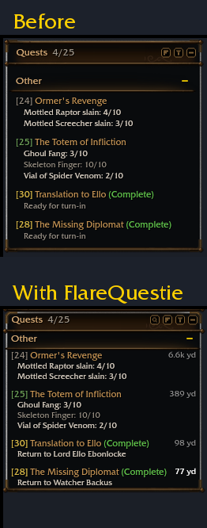
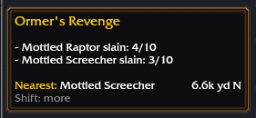

# Meio Flare Questie

For FlareUI: Questie's data in its quest tracker, how far each quest is and who takes it in.

For WoW Forever.

## What it does

[FlareUI](https://www.curseforge.com/projects/1718307) keeps the look,
[Questie](https://www.curseforge.com/projects/334372) supplies where things are.

Works on install:

- Yards to each quest, the nearest in white
- Quest tooltips: the nearest objective or turn-in, with yards and direction
- The rest of the quest chain on hover: "Next: Ormer's Revenge (then 1 more)" and the XP
  left in it
- Quests Questie has no data for yet say so: "Not in Questie's data yet: no yards or
  turn-in"
- The quest count turns orange at 2 free log slots and red when the log is full
- Drag the grip in the tracker's free corner to resize it
- Ready for Questie's next big update, which shuts other addons out of its insides: it
  reads only Questie's database
- FlareUI 7.0.17 or newer: Questie's quest items as buttons in the tracker rows

The rest needs three small FlareUI patches (see Install; without them it says so at
login):

- "Return to" the turn-in NPC on finished quests, and Questie's quest items as buttons on
  FlareUI before 7.0.17
- FlareUI's Sort: Distance orders by the yards
- Show on Map (or Alt-click a quest) opens the map of the nearest objective's zone
- Search: the magnifier in the header lists only the quests that match
- Compact: tighter tracker spacing

Settings: Esc > Options > AddOns > MeioFlareQuestie

- `/flarequestie`: settings
- `/flarequestie help`: the list of commands
- `/flarequestie status`: what Questie finds for your quests, and whether FlareUI is patched
- `/flarequestie distance on|off`: yards to each quest
- `/flarequestie compact on|off`: tighter tracker spacing
- `/flarequestie fonts small|default`: smaller tracker text, or FlareUI's
- `/flarequestie size reset`: FlareUI's default tracker size
- `/flarequestie search <text>`: the same as the magnifier

## Install

Needs FlareUI with its quest tracker on, and Questie (without it, only resizing and compact
spacing work).

The patches, for the features listed above:

1. Install PowerShell 7: `winget install Microsoft.PowerShell`
2. Download this repository (**Code** > **Download ZIP**) and extract it
3. Close WoW, open a terminal in that folder and run
   `pwsh -ExecutionPolicy Bypass -File mods.ps1`
   (WoW elsewhere: add `-AddOns "<your>\_forever_\Interface\AddOns"`)

It copies the addon and patches `FlareUI\Modules\ObjectiveTracker.lua`, keeping a backup in
`backups\`. Each patch in `patches\` shows the old and new lines. A FlareUI update undoes
them: run it again (`mods.ps1 status` checks without changing anything).
Without MeioFlareQuestie the patched tracker works exactly like FlareUI's own.

## Feedback

Bugs, ideas or just a thumbs up: leave a comment on the CurseForge or Wago page you got it from. [GitHub issues](https://github.com/MeioNeiz/MeioFlareQuestie/issues) are welcome too.

## More Meio addons

[Meio Trainer Compare](https://www.curseforge.com/wow/addons/trainercompare) | [Meio Next Stop](https://www.curseforge.com/wow/addons/leavebutton) | [Meio Auto Rank](https://www.curseforge.com/wow/addons/meio-autorank) | [Meio Meter Hover](https://www.curseforge.com/wow/addons/meterhover) | [Meio Map](https://addons.wago.io/addons/meiomap) | [Meio Alts](https://addons.wago.io/addons/meioalts) | [Meio DPS](https://addons.wago.io/addons/meiodps) | [Meio Nameplates](https://addons.wago.io/addons/meioplates) | [Meio Hub](https://addons.wago.io/addons/meiohub) | [Meio Pets](https://addons.wago.io/addons/meiopets) | [Meio XP Meter](https://addons.wago.io/addons/meiostats) | [Meio Bags](https://addons.wago.io/addons/meiobags) | [Meio Fixes](https://addons.wago.io/addons/meiofixes) | [Meio Flight Times](https://addons.wago.io/addons/meioflighttimes) | [Meio Tooltips](https://addons.wago.io/addons/meiotooltipfold) | [Meio Autorun](https://addons.wago.io/addons/meioautorunturn) | [Meio Mail](https://addons.wago.io/addons/meiomail) | [Meio QoL](https://addons.wago.io/addons/meioqol) | [Meio TSM Browse](https://addons.wago.io/addons/tsmbrowse) | [Meio Shards](https://addons.wago.io/addons/meioshards) | [Meionomics](https://www.curseforge.com/wow/addons/meionomics) | [Meio Spike Check](https://addons.wago.io/addons/meiospikecheck) | [Meio BiS Extras](https://addons.wago.io/addons/meiobisextras) | [Meio Buff Thanks](https://addons.wago.io/addons/meiobuffthanks) | [Meio Flare Fixes](https://addons.wago.io/addons/meioflarefixes)

## Licence

[MIT](LICENSE)
