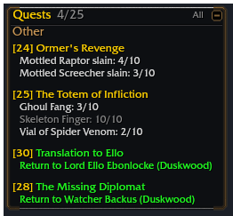
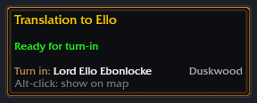

# FlareQuestie

Feeds [FlareUI](https://www.curseforge.com/projects/1718307)'s quest tracker with
[Questie](https://www.curseforge.com/projects/334372)'s quest data in **WoW Forever**: it
knows where your objectives are, which item a quest wants you to use and who to hand it in
to. FlareUI keeps the look; Questie supplies what Blizzard's quest API doesn't.

| Tracker | Objective tooltip | Turn-in tooltip |
|---|---|---|
|  |  |  |

## What it does

On WoW Forever, Blizzard's quest API knows little about where things are, so FlareUI's
tracker can't sort by distance or point you anywhere. With FlareQuestie:

- **Sort: Distance** (FlareUI Settings > Quest Tracker) sorts by the nearest unfinished
  objective, or by the turn-in once a quest is done.
- **Quest item buttons** for the usable items Questie knows (bombs, totems, banners...), not
  only Blizzard's "special" quest items, with their cooldowns.
- **Finished quests** say "Return to Lord Ello Ebonlocke (Duskwood)" instead of "Ready to turn
  in".
- **Show on Map** (FlareUI's quest menu, or **Alt-click** a quest) opens the map at the
  nearest objective and flashes the quest's Questie icons.
- **Quest tooltips** add the nearest objective or turn-in NPC, its zone and how far away.
- **Resize grip**: hover the tracker and drag the grip in its free corner to set the width
  and the most height it takes (it scrolls past that).
- **Compact spacing** (off by default): a smaller header, padding and gaps.

FlareUI's Ctrl-click focus can drive Questie's map too: turn on Questie's option
**Tracker > Follow Blizzard Super Tracking**.

## Commands

| Command | |
|---|---|
| `/flarequestie` | Status: patches in place, how many of your quests Questie can locate |
| `/flarequestie compact on`, `/flarequestie compact off` | Tighter tracker spacing (`/reload` after) |
| `/flarequestie fonts small`, `/flarequestie fonts default` | Tracker fonts 11/10/9 or FlareUI's 13/12/11 (FlareUI's settings can change them after) |
| `/flarequestie size reset` | FlareUI's default tracker width and height |
| `/flarequestie help` | The list of commands |

## Install

You need:

- [FlareUI](https://www.curseforge.com/projects/1718307) (also on
  [Wago](https://addons.wago.io/addons/O67bb0N3)), with its quest tracker turned on.
- [Questie](https://www.curseforge.com/projects/334372), optional but it is where the data
  comes from: without it only the resize grip and compact spacing do anything.

FlareUI's tracker has no way for another addon to plug in, so FlareQuestie comes with two
small FlareUI patches (see [FlareUI patches](#flareui-patches)). The installer copies the
addon and applies them:

1. Install PowerShell 7 if you don't have it. In a terminal: `winget install Microsoft.PowerShell`
   (Windows PowerShell 5, the one built into Windows, won't run the installer).
2. Download this repository (green **Code** button, **Download ZIP**) and extract it anywhere.
3. Close WoW. Open a terminal in the extracted folder and run:

   ```
   pwsh -ExecutionPolicy Bypass -File mods.ps1
   ```

   If WoW isn't in `C:\Program Files (x86)\World of Warcraft`, add the path to your AddOns
   folder: `-AddOns "D:\Games\World of Warcraft\_forever_\Interface\AddOns"`.
4. Start WoW and type `/flarequestie` to check that both patches are in.

`-ExecutionPolicy Bypass` is needed because Windows blocks scripts downloaded from the
internet. Read `mods.ps1` first if you'd like to check what it does: it only copies the
addon and edits the FlareUI file the patches name, and keeps a backup of each file it
changes in `backups\`.

Without the installer, copy `addons\FlareQuestie` into `_forever_\Interface\AddOns` by hand.
FlareQuestie then says at login that FlareUI isn't patched, and only the resize grip and the
tooltip lines work.

**After a FlareUI update** run the installer again: the update undoes the patches, and
FlareQuestie tells you so at login. To check without changing anything:
`pwsh -ExecutionPolicy Bypass -File mods.ps1 status`. If it reports a patch as **BROKEN**,
FlareUI changed that code; look for a newer version of this repository.

## FlareUI patches

Both edit `FlareUI\Modules\ObjectiveTracker.lua`. `mods.ps1` finds the exact lines each
patch names (`patches\*.patch`: the old lines and the new ones side by side, every new line
marked `LOCAL FIX`) and refuses to change anything when FlareUI's code has moved on.

| Patch | What it changes in FlareUI |
|---|---|
| 52-flareui-tracker-questie-hooks | Adds optional hook points to the tracker: distance, quest item, "Return to" text and Show on Map each ask FlareQuestie first and fall back to FlareUI's own code when it has no answer. Adds Alt-click = Show on Map. |
| 53-flareui-tracker-expose-layout | Makes the tracker's spacing table reachable, so compact mode can tighten it. |

Without FlareQuestie installed, the patched tracker behaves exactly like FlareUI's own. To
undo one: `pwsh -ExecutionPolicy Bypass -File mods.ps1 revert <patch-name>`, or reinstall
FlareUI.

## Limits

- Questie needs a few seconds after login to build its quest data; the tracker redraws when
  it has.
- Distances are straight lines to Questie's nearest known spawn, not travel time.
- Edit Mode's Quest Spacing setting overrides compact mode's gap between quests.
- Made and tested on an English client with FlareUI 6.4.1 and Questie 12.8.0.

## Licence

[MIT](LICENSE)
